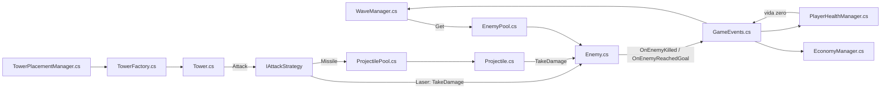

<div align="center">

# 🎮 Ball-X-Pitt

**Um jogo de defesa frenético construído em Unity.**<br/>
Proteja seu núcleo contra ondas de inimigos neon em um ambiente cibernético.

[](https://unity.com/)
[](https://github.com/juninmd/ball-x-pitt/actions/workflows/validate.yml)
[](LICENSE)

<br/>

TODO(screenshot): tela principal da cena `Assets/Scenes/SampleScene.unity` para o hero da header (não capturada: Unity Editor não está instalado neste ambiente)

</div>

> Um jogo de defesa frenético construído em Unity.

## 📝 Descrição

**Ball-X-Pitt** (também conhecido como Neon Defense) é um jogo de ação e defesa onde você deve proteger seu núcleo contra ondas de inimigos neon em um ambiente cibernético. O jogo utiliza o sistema de renderização Universal Render Pipeline (URP) da Unity para visuais vibrantes e performance otimizada.

## ✨ Funcionalidades

- **Ondas de inimigos** configuráveis por `WaveConfig` (grupos, quantidade e intervalo de spawn).
- **Torres** com estratégia de ataque Laser ou Missile, configuradas por `TowerConfig`.
- **Economia em bits** (`EconomyManager`): ganha bits ao derrubar inimigos.
- **Vida do núcleo** (`PlayerHealthManager`): o jogo termina quando ela chega a zero.
- **Pools** de inimigos e projéteis (`EnemyPool`, `ProjectilePool`).
- **Módulo BallXPitt**: bolas com efeitos (bumper, destruição, multiplicador de pontuação) e `ScoreManager`.

## 🛠️ Tech Stack

- **Engine**: [Unity 6000.3.6f1](https://unity.com/) (Unity 6)
- **Render Pipeline**: URP (Universal Render Pipeline) 17.3.0
- **Linguagem**: C#
- **Input System**: New Unity Input System 1.18.0

## 🚀 Como Abrir o Projeto

1. Certifique-se de ter o **Unity Hub** instalado.
2. Clone o repositório:
   ```bash
   git clone https://github.com/juninmd/ball-x-pitt.git
   ```
3. No Unity Hub, clique em **Add** e selecione a pasta do projeto.
4. Selecione a versão do Unity indicada em `ProjectSettings/ProjectVersion.txt` (6000.3.6f1).
5. Abra a cena principal em `Assets/Scenes/SampleScene.unity`.

## 🧭 Como Funciona

Fluxo principal dos scripts de `Assets/Scripts/NeonDefense`: ondas geram inimigos, torres disparam, e os eventos estáticos de `GameEvents` acoplam economia e vida do jogador.



- Os inimigos saem de um pool, evitando `Instantiate` a cada spawn.
- Estratégias de ataque ficam em classes separadas (`LaserAttackStrategy`, `MissileAttackStrategy`) atrás da interface `IAttackStrategy`.
- Economia e vida não se referenciam diretamente: reagem a eventos em `GameEvents`.

## ⚙️ Configuração

Cena, Managers, pools e ScriptableObjects (`EnemyConfig`, `TowerConfig`, `WaveConfig`) são montados no Editor. O passo a passo está em [SETUP.md](SETUP.md).

## 🧪 Desenvolvimento

Comandos de linha de comando:

```bash
git clone https://github.com/juninmd/ball-x-pitt.git   # baixa o código-fonte
```

Pelo Unity Editor (versão 6000.3.6f1):

- **Abrir o projeto**: Unity Hub → Add → pasta do repositório.
- **Rodar o jogo**: abra `Assets/Scenes/SampleScene.unity` e aperte Play.
- **Testes EditMode**: Window → General → Test Runner → EditMode. Os testes atuais cobrem `EconomyManagerTests` e `PlayerHealthManagerTests` (em `Assets/Tests/EditMode`).

### Builds e release

- O workflow `.github/workflows/deploy.yml` roda ao criar tag `v*`: gera builds de `StandaloneWindows64` e `WebGL` com `game-ci/unity-builder` e cria a release com os dois zips.
- Secrets exigidos no GitHub: `UNITY_LICENSE`, `UNITY_EMAIL` e `UNITY_PASSWORD` (detalhes em [SETUP.md](SETUP.md)).

## 🤝 Contribuição

Veja [CONTRIBUTING.md](CONTRIBUTING.md) para o estilo de código C# e o fluxo de Pull Requests.

## ⚠️ Limitações conhecidas

- Não há build publicado ainda: as releases atuais estão em rascunho (Draft).
- Os testes automatizados cobrem apenas `EconomyManager` e `PlayerHealthManager`.
- Física e pooling precisam de smoke test manual no Unity; o motivo está em [LIMITATIONS.md](LIMITATIONS.md).
- Port mobile, níveis extras e outras fases são planejamento, não código: veja [ROADMAP.md](ROADMAP.md).

## 📄 Licença

MIT © 2026 juninmd. Veja [LICENSE](LICENSE).
